<!-- Os SVGs vêm do branch "output" e são gerados por scripts/generate.py (.github/workflows/snake.yml). -->

<a href="https://github.com/GustaReis-bit"></a>

<a href="mailto:gustavoreis5905@gmail.com?subject=Eu%20vi%20seu%20perfil%20no%20GitHub&body=Ol%C3%A1%20Gustavo.%20Meu%20nome%20%C3%A9%20_______">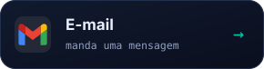</a>
<a href="https://portifolio-gustavo-tan.vercel.app">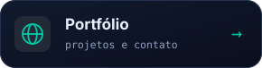</a>

  


  

<a href="https://github.com/GustaReis-bit/Portal-do-Aluno">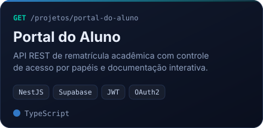</a>
<a href="https://github.com/GustaReis-bit/Rematricula-API">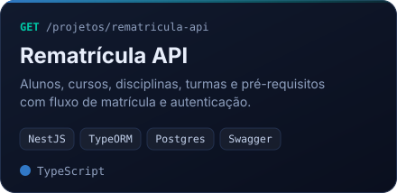</a>
<a href="https://github.com/GustaReis-bit/catalogo-de-produtos">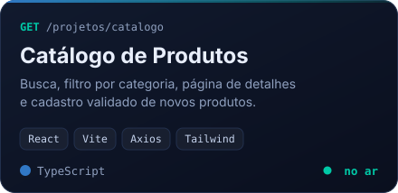</a>
<a href="https://github.com/GustaReis-bit/PortifolioGustavo">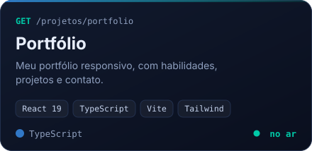</a>
<a href="https://github.com/GustaReis-bit/quiz_mobile">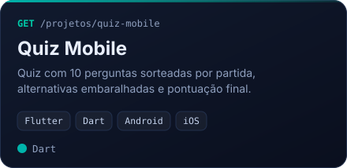</a>
<a href="https://github.com/GustaReis-bit/ping-tool">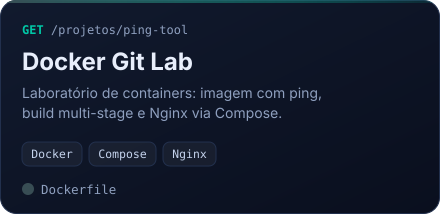</a>

Ao vivo: <a href="https://catalogo-de-produtos-zeta.vercel.app">Catálogo de Produtos</a> · <a href="https://portifolio-gustavo-tan.vercel.app">Portfólio</a> &nbsp;|&nbsp; Mais no GitHub: <a href="https://github.com/GustaReis-bit/Calculadora">Calculadora</a> · <a href="https://github.com/GustaReis-bit/Rio200-Graus">Rio 200 Graus</a>

  


  


<picture>
  <source media="(prefers-color-scheme: dark)" srcset="https://raw.githubusercontent.com/GustaReis-bit/GustaReis-bit/output/github-contribution-grid-snake-dark.svg"/>
  <source media="(prefers-color-scheme: light)" srcset="https://raw.githubusercontent.com/GustaReis-bit/GustaReis-bit/output/github-contribution-grid-snake.svg"/>
  
</picture>

  


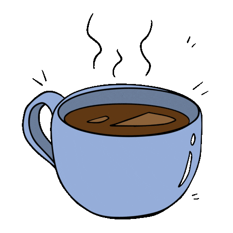

**Bora trocar uma ideia sobre back-end, novas tecnologias ou oportunidades?**

  

